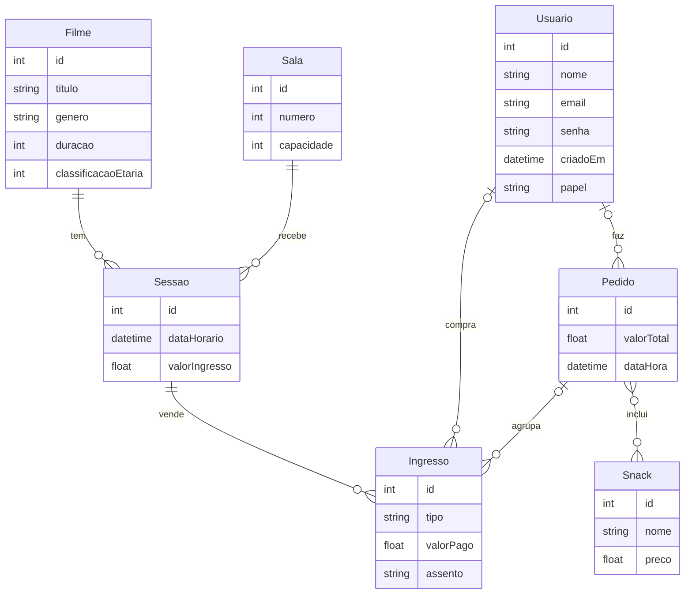

# 🎬 Cinema API — NestJS + Prisma + JWT

Backend do sistema de cinema. Expõe uma API REST documentada com Swagger, que é consumida pelo **frontend web** (`frontend/`) e pelo **app mobile** (`../CinemaApp`).

> Visão geral do projeto completo e setup rápido: [README da raiz](../README.md).

## 🛠️ Stack

| | |
|---|---|
| Framework | NestJS 11 |
| ORM / banco | Prisma 6 + SQLite |
| Autenticação | JWT (`@nestjs/jwt` + Passport), senhas com `bcryptjs`, perfis `ADMIN` e `CLIENTE` |
| E-mail | `nodemailer` (SMTP opcional) |
| Validação | `class-validator` + `ValidationPipe` global (`whitelist: true`) |
| Documentação | Swagger (`@nestjs/swagger`) em `/api` |

---

## 🚀 Setup

Pré-requisito: Node.js 20 ou mais recente.

```bash
cd cinema-nestjs-swagger-main
cp .env.example .env     # configura DATABASE_URL e JWT_SECRET
npm install
npx prisma migrate dev   # cria o banco SQLite e aplica as migrations
npm run seed             # popula com dados de teste
npm run start:dev        # sobe em modo watch
```

| Endereço | O quê |
|---|---|
| http://localhost:3000 | Frontend web (build em `public/`) |
| http://localhost:3000/api | Swagger (documentação interativa) |
| http://localhost:3000/filme, `/sessao`, ... | Rotas da API |

O servidor escuta em `0.0.0.0:3000` com CORS liberado (`origin: '*'`), então aceita conexões do celular e de outras máquinas da rede local.

### Variáveis de ambiente (`.env`)

| Variável | Exemplo | Descrição |
|---|---|---|
| `DATABASE_URL` | `file:./dev.db` | Caminho do banco SQLite, **relativo à pasta `prisma/`**. O exemplo cria `prisma/dev.db`. |
| `JWT_SECRET` | `troque-esta-chave` | Chave de assinatura dos tokens. Se não for definida, o código usa um valor padrão inseguro (`cinema-secret-key`). |
| `FRONTEND_URL` | `http://localhost:3000` | Endereço do site, usado no link do e-mail de redefinição de senha. |
| `SMTP_HOST`, `SMTP_PORT`, `SMTP_USER`, `SMTP_PASS`, `SMTP_FROM` | `smtp.exemplo.com`, `587`, ... | Servidor de e-mail (opcional). **Sem `SMTP_HOST`, o e-mail não é enviado e o link de redefinição aparece no console do servidor.** A porta `465` usa conexão segura direta; as outras usam STARTTLS. |

O `.env` é carregado ao iniciar o servidor (`src/load-env.ts`), e variáveis já definidas no ambiente têm prioridade sobre ele. O `.env` e os bancos (`*.db`) ficam fora do git.

### Scripts

| Comando | Descrição |
|---|---|
| `npm run start:dev` | Sobe em modo watch (recarrega ao salvar) |
| `npm run start` | Sobe sem watch |
| `npm run build` / `npm run start:prod` | Compila para `dist/` e roda a versão compilada |
| `npm run seed` | Popula o banco com dados de teste. Rodar de novo **duplica** filmes, sessões e snacks; salas e usuário não se repetem. |
| `npm run lint` / `npm run format` | ESLint e Prettier |
| `npm test` | Testes unitários (`src/**/*.spec.ts`) |
| `npm run test:e2e` | Testes e2e (`test/`). Usam um banco separado, `prisma/test.db`, recriado do zero a cada execução; o banco de desenvolvimento não é tocado. |
| `npx prisma studio` | Abre o banco no navegador para ver e editar os dados |

---

## 📁 Estrutura

```
cinema-nestjs-swagger-main/
├── src/
│   ├── main.ts              # Bootstrap: carrega o .env, Swagger, porta 3000
│   ├── configurar-app.ts    # CORS e ValidationPipe (compartilhado com os testes e2e)
│   ├── app.module.ts        # Registra os módulos, o frontend estático e os guards globais
│   ├── auth/                # Cadastro, login, JWT, perfis, recuperação de senha e e-mail
│   ├── prisma/              # PrismaService (conexão com o banco)
│   ├── filme/  sala/  sessao/  snack/   # CRUD completo
│   └── ingresso/  pedido/               # Compra (preços calculados no servidor) e consulta
├── prisma/
│   ├── schema.prisma        # Modelo de dados
│   ├── migrations/          # Histórico de migrations
│   └── seed.ts              # Dados de teste
├── frontend/                # Frontend web (React + Vite)
├── public/                  # Build do frontend (gerado por `npm run build` no frontend)
├── test/                    # Testes e2e
└── generate.js              # Script usado para gerar os CRUDs com o Nest CLI
```

---

## 🗄️ Modelo de dados



- `Usuario.papel` é `"ADMIN"` ou `"CLIENTE"` (padrão).
- `Ingresso.usuarioId` e `Pedido.usuarioId` ficam vazios (`null`) nas compras de visitante.
- `Ingresso.tipo` é `"Inteira"` ou `"Meia"`, e `Ingresso.assento` guarda a poltrona (ex.: `"B4"`).
- `Filme.duracao` é em minutos, e `Filme.genero` é texto livre (ex.: `"Ação"`).
- Apagar um filme ou uma sala apaga as sessões e os ingressos ligados a ele (`onDelete: Cascade`).

Para alterar o modelo, edite `prisma/schema.prisma` e rode `npx prisma migrate dev --name <descricao>`.

---

## 🔐 Autenticação e perfis

Dois guards são registrados como **guards globais** (`APP_GUARD`) e rodam nesta ordem:

1. **`JwtAuthGuard`:** **todas as rotas exigem JWT por padrão**. As rotas abertas são marcadas com `@Public()`. Nelas o token é **opcional**: se vier um token válido, o usuário é identificado (`req.user`); se vier vencido ou inválido, a requisição segue como visitante, sem erro.
2. **`AdminGuard`:** nas rotas marcadas com `@AdminOnly()`, só deixa passar quem tem papel `ADMIN` (os demais recebem 403).

```ts
@Get()
@Public()          // aberta; token opcional
findAll() { ... }

@Post()
@AdminOnly()       // exige JWT de um ADMIN
create(@Body() dto: CreateFilmeDto) { ... }

@Get()
findMine(@UsuarioAtual() user: UsuarioAutenticado) { ... }  // usuário logado
```

**Perfis:**
- **`ADMIN`:** gerencia filmes, salas, sessões e snacks, e vê os ingressos e pedidos de todos.
- **`CLIENTE`:** é o perfil de todo cadastro feito por `POST /auth/register`, mesmo que o corpo da requisição peça outro papel. O cliente vê só os próprios ingressos e pedidos.
- O papel é lido do banco a cada requisição, e não do token. Assim, mudar o papel de alguém (ou apagar a conta) vale na hora.
- Para promover um usuário a admin, edite o campo `papel` no `npx prisma studio`.

**Usando o token:**
1. Faça login em `POST /auth/login` com `{ "email", "senha" }`. A resposta traz o `access_token` e o `user` (com o `papel`).
2. Envie o token nas próximas chamadas, no cabeçalho `Authorization: Bearer <access_token>`.
3. O token vale por **7 dias**.

**No Swagger:** faça login em `POST /auth/login`, copie o `access_token`, clique em **Authorize** (cadeado no topo) e cole o token.

### Recuperação de senha

1. `POST /auth/forgot-password` com `{ "email" }`. A resposta é sempre a mesma, exista ou não a conta, para não revelar quem está cadastrado.
2. Se a conta existe, o usuário recebe por e-mail um link para `FRONTEND_URL/redefinir-senha?token=...`, válido por **1 hora**. Sem SMTP configurado, o link aparece no console do servidor.
3. A página `/redefinir-senha` do frontend web chama `POST /auth/reset-password` com `{ "token", "novaSenha" }`.

O link é de **uso único**: o token é assinado com a chave do JWT combinada com o hash da senha atual, então deixa de valer assim que a senha muda. Um token de login não serve como token de redefinição.

---

## 🛒 Compra

A compra é aberta a **visitantes** (sem login), que é como o site funciona. Quando a requisição traz um token válido, como no app mobile, os ingressos e o pedido ficam vinculados à conta do token.

- **Preços calculados no servidor:** o ingresso custa o `valorIngresso` da sessão (metade na meia), e o total do pedido é a soma dos ingressos com os snacks. Campos como `valorPago`, `valorTotal` e `usuarioId` enviados pelo cliente são **descartados**.
- **Dois formatos de `POST /pedido`:**
  - `{ "ingressoIds": [1, 2], "snackIds": [3, 3] }`: usa ingressos já criados por `POST /ingresso`. Para mais de uma unidade de um snack, repita o ID.
  - `{ "sessaoId": 1, "ingressos": [{ "tipo": "Meia", "assento": "B4" }], "snacks": [{ "snackId": 3, "quantidade": 2 }] }`: cria os ingressos junto com o pedido.
- **Validações do pedido:** precisa ter pelo menos um ingresso (400). Cada ingresso tem que existir (404), não pode estar em outro pedido (409) e tem que ser do mesmo comprador (403). Snacks inexistentes também dão 404. O pedido é criado numa transação: se algo falhar, nada fica gravado.

---

## 📡 Rotas

🔓 = pública · 🔓⁺ = pública, com token opcional · 🔒 = exige JWT · 👑 = exige JWT de admin

| Recurso | Método e rota | Acesso |
|---|---|---|
| **Auth** | `POST /auth/register` | 🔓 |
| | `POST /auth/login` | 🔓 |
| | `POST /auth/forgot-password` | 🔓 |
| | `POST /auth/reset-password` | 🔓 |
| | `GET /auth/me` | 🔒 |
| **Filmes** | `GET /filme` · `GET /filme/:id` | 🔓 |
| | `POST /filme` · `PATCH /filme/:id` · `DELETE /filme/:id` | 👑 |
| **Salas** | `GET /sala` · `GET /sala/:id` | 🔓 |
| | `POST /sala` · `PATCH /sala/:id` · `DELETE /sala/:id` | 👑 |
| **Sessões** | `GET /sessao` · `GET /sessao/:id` | 🔓 |
| | `POST /sessao` · `PATCH /sessao/:id` · `DELETE /sessao/:id` | 👑 |
| **Snacks** | `GET /snack` · `GET /snack/:id` | 🔓 |
| | `POST /snack` · `PATCH /snack/:id` · `DELETE /snack/:id` | 👑 |
| **Ingressos** | `POST /ingresso` | 🔓⁺ |
| | `GET /ingresso` · `GET /ingresso/:id` | 🔒 (cliente vê os seus; admin vê todos) |
| **Pedidos** | `POST /pedido` | 🔓⁺ |
| | `GET /pedido` · `GET /pedido/:id` | 🔒 (cliente vê os seus; admin vê todos) |

Buscar por ID um ingresso ou pedido de outra pessoa responde **404**, sem revelar que o registro existe. Os formatos de entrada e saída de cada rota estão no Swagger.

---

## 🌱 Dados de teste (seed)

O `npm run seed` cria:

- **Administrador:** `admin@cinema.com` / `senha123` (papel `ADMIN`)
- **Salas:** sala 1 (64 lugares) e sala 2 (48 lugares)
- **Filmes:** Interestelar, Vingadores: Ultimato, O Rei Leão e Coringa, com sessões
- **Snacks:** pipocas, refrigerante, água, nachos e combo

---

## 🖥️ Frontend web

O frontend em React + Vite fica em `frontend/` e pode ser usado de duas formas:

| Forma | Endereço | Quando usar |
|---|---|---|
| Servido pelo backend | http://localhost:3000 | Para usar ou apresentar. O backend entrega o build que está em `public/` (via `ServeStaticModule`). |
| Servidor do Vite | http://localhost:5173 | Para desenvolver o frontend, com recarregamento automático ao salvar. |

| Página | Caminho | Quem usa |
|---|---|---|
| Cliente | `/` | Visitantes: escolher filme, sessão, assentos e snacks, e comprar. |
| Painel admin | `/admin` | Só usuários `ADMIN`: o login de um cliente é recusado. |
| Redefinir senha | `/redefinir-senha?token=...` | Aberta pelo link do e-mail de recuperação. |

```bash
cd frontend
npm install
npm run dev      # servidor do Vite em http://localhost:5173 (chama a API em http://localhost:3000)
npm run build    # gera o build em ../public, que o backend passa a servir
```

**Depois de alterar o frontend,** rode `npm run build` para atualizar a versão servida em http://localhost:3000. Caso contrário, ela continua mostrando o build anterior.

O `ServeStaticModule` só responde a requisições `GET` que nenhuma rota da API atende. Por isso as rotas da API têm prioridade, e qualquer outro caminho devolve o `index.html` do frontend. O `/api` (Swagger) fica excluído.

---

## ⚠️ Problemas conhecidos

Pontos identificados no código que ainda precisam de correção:

| Problema | Detalhe |
|---|---|
| **Quantidade de snacks não fica gravada** | A ligação entre `Pedido` e `Snack` no banco é N:N simples, que não guarda quantidade. Um pedido com 2 pipocas grava a pipoca uma vez só. O `valorTotal` está certo, porque conta as unidades, mas a lista de snacks do pedido não mostra a quantidade. Corrigir exige uma tabela intermediária com o campo `quantidade`. |
| **O mesmo assento pode ser vendido duas vezes** | O backend não verifica se o assento já foi vendido naquela sessão. Além disso, o mapa de assentos do app mobile é simulado: ele sorteia quais aparecem ocupados a partir da quantidade vendida, e não mostra os assentos reais. |
