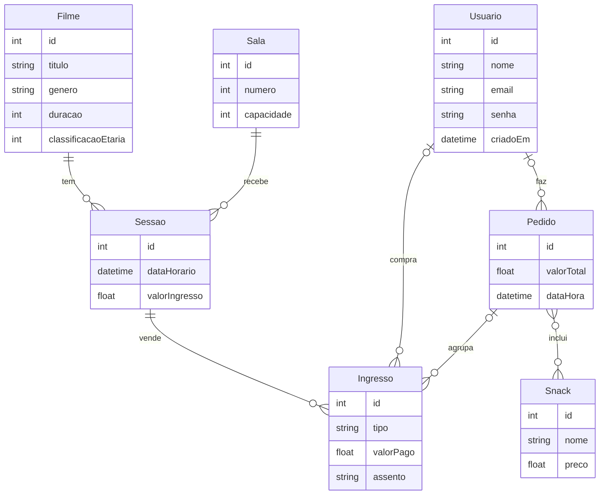

# 🎬 Cinema API — NestJS + Prisma + JWT

Backend do sistema de cinema. Expõe uma API REST documentada com Swagger, que é consumida pelo **frontend web** (`frontend/`) e pelo **app mobile** (`../CinemaApp`).

> Visão geral do projeto completo e setup rápido: [README da raiz](../README.md).

## 🛠️ Stack

| | |
|---|---|
| Framework | NestJS 11 |
| ORM / banco | Prisma 6 + SQLite |
| Autenticação | JWT (`@nestjs/jwt` + Passport), senhas com `bcryptjs` |
| Validação | `class-validator` + `ValidationPipe` global (`whitelist: true`) |
| Documentação | Swagger (`@nestjs/swagger`) em `/api` |

---

## 🚀 Setup

Pré-requisito: Node.js 20 ou mais recente.

```bash
cd cinema-nestjs-swagger-main
cp .env.example .env     # configura DATABASE_URL e JWT_SECRET
npm install
npx prisma migrate dev   # cria o banco SQLite e aplica as migrations
npm run seed             # popula com dados de teste
npm run start:dev        # sobe em modo watch
```

| Endereço | O quê |
|---|---|
| http://localhost:3000 | Frontend web (build em `public/`) |
| http://localhost:3000/api | Swagger (documentação interativa) |
| http://localhost:3000/filme, `/sessao`, ... | Rotas da API |

O servidor escuta em `0.0.0.0:3000` com CORS liberado (`origin: '*'`), então aceita conexões do celular e de outras máquinas da rede local.

### Variáveis de ambiente (`.env`)

| Variável | Exemplo | Descrição |
|---|---|---|
| `DATABASE_URL` | `file:./dev.db` | Caminho do banco SQLite, **relativo à pasta `prisma/`**. O exemplo cria `prisma/dev.db`. |
| `JWT_SECRET` | `troque-esta-chave` | Chave de assinatura dos tokens. Se não for definida, o código usa um valor padrão inseguro (`cinema-secret-key`). |

O `.env` e o banco (`*.db`) ficam fora do git.

### Scripts

| Comando | Descrição |
|---|---|
| `npm run start:dev` | Sobe em modo watch (recarrega ao salvar) |
| `npm run start` | Sobe sem watch |
| `npm run build` / `npm run start:prod` | Compila para `dist/` e roda a versão compilada |
| `npm run seed` | Popula o banco com dados de teste. Rodar de novo **duplica** filmes, sessões e snacks; salas e usuário não se repetem. |
| `npm run lint` / `npm run format` | ESLint e Prettier |
| `npm test` | Testes unitários (`src/**/*.spec.ts`) |
| `npm run test:e2e` | Testes e2e (`test/`). Usam o banco do `.env`, então rode as migrations e o seed antes. |
| `npx prisma studio` | Abre o banco no navegador para ver e editar os dados |

---

## 📁 Estrutura

```
cinema-nestjs-swagger-main/
├── src/
│   ├── main.ts              # Bootstrap: CORS, ValidationPipe, Swagger, porta 3000
│   ├── app.module.ts        # Registra os módulos e o guard JWT global
│   ├── auth/                # Cadastro, login, JWT, guard global e decorator @Public()
│   ├── prisma/              # PrismaService (conexão com o banco)
│   ├── filme/  sala/  sessao/  snack/   # CRUD completo
│   └── ingresso/  pedido/               # Criação e consulta
├── prisma/
│   ├── schema.prisma        # Modelo de dados
│   ├── migrations/          # Histórico de migrations
│   └── seed.ts              # Dados de teste
├── frontend/                # Frontend web (React + Vite)
├── public/                  # Build do frontend (gerado por `npm run build` no frontend)
├── test/                    # Testes e2e
└── generate.js              # Script usado para gerar os CRUDs com o Nest CLI
```

---

## 🗄️ Modelo de dados



- `Ingresso.tipo` é `"Inteira"` ou `"Meia"`, e `Ingresso.assento` guarda a poltrona (ex.: `"B4"`).
- `Filme.duracao` é em minutos, e `Filme.genero` é texto livre (ex.: `"Ação"`).
- Apagar um filme ou uma sala apaga as sessões e os ingressos ligados a ele (`onDelete: Cascade`).

Para alterar o modelo, edite `prisma/schema.prisma` e rode `npx prisma migrate dev --name <descricao>`.

---

## 🔐 Autenticação

O `JwtAuthGuard` é registrado como **guard global** (`APP_GUARD`). Por isso **todas as rotas exigem JWT por padrão**, e as rotas abertas são marcadas com o decorator `@Public()`.

```ts
@Get()
@Public()          // libera a rota sem token
findAll() { ... }
```

1. Faça login em `POST /auth/login` com `{ "email", "senha" }`. A resposta traz o `access_token`.
2. Envie o token nas próximas chamadas, no cabeçalho `Authorization: Bearer <access_token>`.
3. O token vale por **7 dias**.

**No Swagger:** faça login em `POST /auth/login`, copie o `access_token`, clique em **Authorize** (cadeado no topo) e cole o token.

---

## 📡 Rotas

🔓 = pública · 🔒 = exige JWT

| Recurso | Método e rota | Acesso |
|---|---|---|
| **Auth** | `POST /auth/register` | 🔓 |
| | `POST /auth/login` | 🔓 |
| | `POST /auth/forgot-password` | 🔓 |
| | `GET /auth/me` | 🔒 |
| **Filmes** | `GET /filme` · `GET /filme/:id` | 🔓 |
| | `POST /filme` · `PATCH /filme/:id` · `DELETE /filme/:id` | 🔒 |
| **Salas** | `GET /sala` · `GET /sala/:id` | 🔓 |
| | `POST /sala` · `PATCH /sala/:id` · `DELETE /sala/:id` | 🔒 |
| **Sessões** | `GET /sessao` · `GET /sessao/:id` | 🔓 |
| | `POST /sessao` · `PATCH /sessao/:id` · `DELETE /sessao/:id` | 🔒 |
| **Snacks** | `GET /snack` · `GET /snack/:id` | 🔓 |
| | `POST /snack` · `PATCH /snack/:id` · `DELETE /snack/:id` | 🔒 |
| **Ingressos** | `POST /ingresso` | 🔓 |
| | `GET /ingresso` · `GET /ingresso/:id` | 🔒 |
| **Pedidos** | `POST /pedido` | 🔓 |
| | `GET /pedido` · `GET /pedido/:id` | 🔒 |

Os formatos de entrada e saída de cada rota estão no Swagger.

---

## 🌱 Dados de teste (seed)

O `npm run seed` cria:

- **Usuário:** `admin@cinema.com` / `senha123`
- **Salas:** sala 1 (64 lugares) e sala 2 (48 lugares)
- **Filmes:** Interestelar, Vingadores: Ultimato, O Rei Leão e Coringa, com sessões
- **Snacks:** pipocas, refrigerante, água, nachos e combo

---

## 🖥️ Frontend web

O frontend em React + Vite fica em `frontend/` e pode ser usado de duas formas:

| Forma | Endereço | Quando usar |
|---|---|---|
| Servido pelo backend | http://localhost:3000 | Para usar ou apresentar. O backend entrega o build que está em `public/` (via `ServeStaticModule`). |
| Servidor do Vite | http://localhost:5173 | Para desenvolver o frontend, com recarregamento automático ao salvar. |

```bash
cd frontend
npm install
npm run dev      # servidor do Vite em http://localhost:5173 (chama a API em http://localhost:3000)
npm run build    # gera o build em ../public, que o backend passa a servir
```

**Depois de alterar o frontend,** rode `npm run build` para atualizar a versão servida em http://localhost:3000. Caso contrário, ela continua mostrando o build anterior.

O `ServeStaticModule` só responde a requisições `GET` que nenhuma rota da API atende. Por isso as rotas da API têm prioridade, e qualquer outro caminho devolve o `index.html` do frontend. O `/api` (Swagger) fica excluído.

---

## ⚠️ Problemas conhecidos

Pontos identificados no código que ainda precisam de correção:

| Problema | Detalhe |
|---|---|
| **Não existe perfil de administrador** | Qualquer usuário logado pode criar, editar e apagar filmes, salas, sessões e snacks. |
| **Compra sem autenticação** | `POST /ingresso` e `POST /pedido` são públicas, e o `usuarioId` é enviado pelo próprio cliente, em vez de vir do token. |
| **Listagens sem filtro por usuário** | `GET /ingresso` e `GET /pedido` retornam os registros de **todos** os usuários. |
| **`POST /pedido` sem validação** | O corpo é recebido como `any`, sem DTO, então o `ValidationPipe` não valida nada. |
| **Recuperação de senha incompleta** | `POST /auth/forgot-password` só gera um token de redefinição e o imprime no console do servidor. Não há envio de e-mail nem rota para redefinir a senha. |
